# ai-collab-playbook——作为一名在读博士生，我在日常是如何与 AI 协作的？

> 公开版本 / Public edition: 2026-10-13

---

## 前言

我是一名人工智能方向的在读博士生，大概在 ChatGPT 出来以后还是 GPT-3.5 的时候就比较重度使用 AI 以及 AI 工具了。几年下来，AI 已经渗透到我工作和学习很多环节，有一些心得想分享一下~

**当同事，不当工具**

我认为至少未来几年，应该是**人机协作的时代**

现在回头看，我觉得过去很多所谓“会用电脑”，其实有相当一部分是在给机器当翻译。人脑子里明明只有一个目标，落到电脑上，却总要拆成一堆很零碎的动作。很多时候事情本身并没有多么复杂，感觉复杂是因为旧系统根本听不懂你的意图，只能逼着你先把目标嚼碎，再翻译成它能执行的步骤。

比如做 SQL 查询，你脑子里明明只是想看一个简单的业务趋势，但因为系统听不懂，你不得不花一个小时去嵌套三层 LEFT JOIN、对齐 GROUP BY 的聚合字段，小心翼翼地用机器听得懂的语法去和数据库交互。

但在大语言模型背景下，人和机器的语言、想法是可以对齐的。这也是为什么我现在越来越自然地把 AI 当同事的原因。

下面我会从日常使用、科研、工具链这些角度展开聊聊

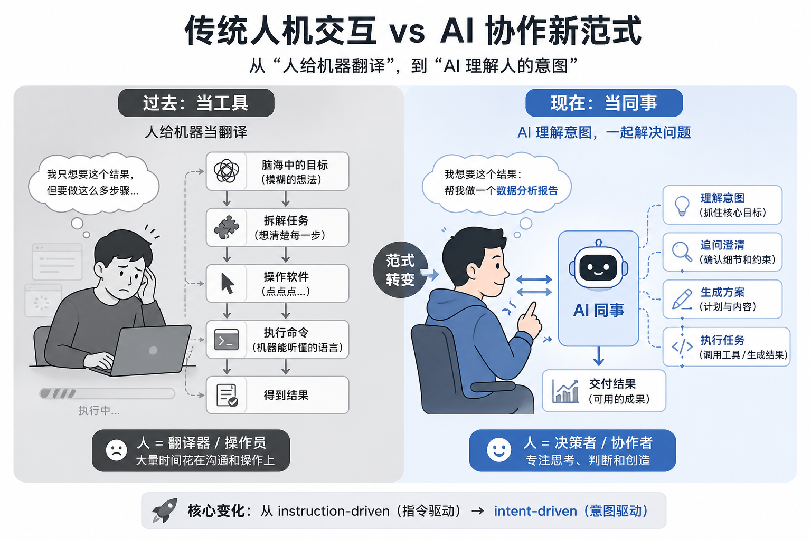

---

## 一、日常使用：AI 作为随身顾问
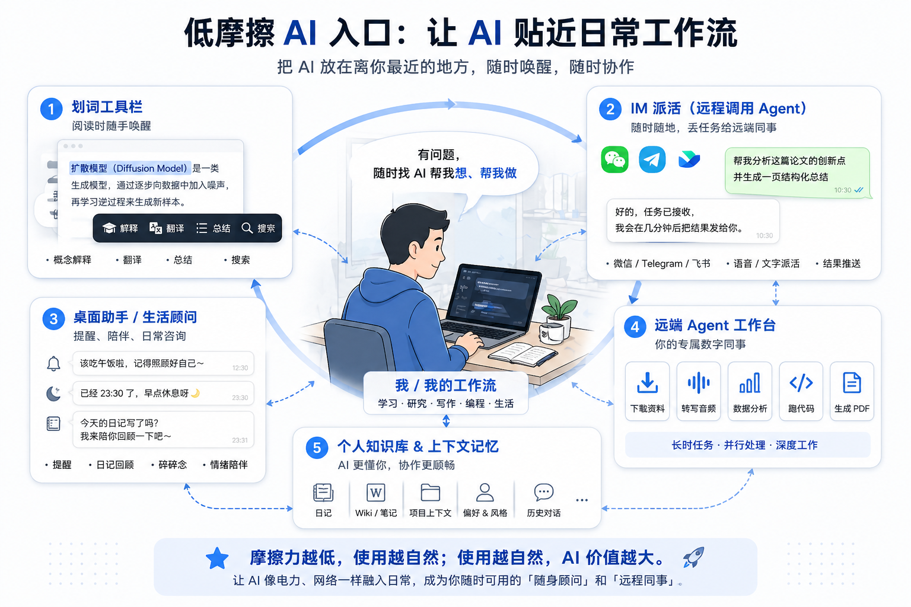

### 降低使用摩擦力

并不是所有任务都值得拉起本地 Agent、走 API、配一套完整工作流。很多轻量的一次性的事情，直接给网页端 ChatGPT 的 Agent 模式就够了——入口短、成本低、上下文负担小。

应用侧也是类似的逻辑。我现在还会用 `豆包` 的**划词工具栏功能**，它能在电脑全局划词唤醒。最方便的是可以自定义划词动作，比如我写了一个“概念解释器”，划词后直接给出学术概念的通俗解释，省掉了打开浏览器、复制、粘贴、重新描述问题这一整串动作。

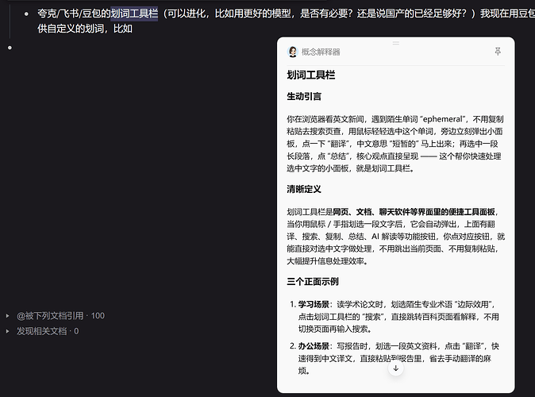

此外，`豆包浏览器` 的网页翻译、页面总结、针对当前网页提问这些功能也挺实用。它的价值不在模型能力是否顶尖，而在于它离用户足够近：我不用把内容搬到另一个窗口，也不用重新组织上下文，直接在当前页面处理就行。

所以我现在会更刻意地按任务重量选择 AI 入口：**轻量任务交给网页端或应用端，项目级任务先用网页端构思好以后再交给本地 Agent 执行**。日常使用 AI 时，最重要的是尽量**降低使用 AI 的摩擦力**。入口越贴近工作流，越容易形成高频使用；用得越自然，AI 的价值才越容易被挖出来。（大家如果有更好用的应用侧工具，也可以留言推荐~）

类似的，也可以把 AI 当成一个随手可用的“事实检验器”，现在制造谣言的成本实在是太低了。**尤其是 AI 生成的文字、图片和视频越来越逼真，营销号又非常擅长制造焦虑和情绪**。每天接触这些信息，会给人带来很大的认知负担。这些工作可以交给 AI 辅助完成（这是 AI 所擅长的），让 AI 去查找原始来源、核对证据、寻找反例，区分哪些是事实、哪些是推断、哪些只是观点。不过，AI 是帮助我们寻找和整理证据的，不是替我们决定什么是真相的。我希望长期使用这样的工具，最终培养的不是「遇到问题就问 AI」的习惯，而是自己主动求真的能力。面对身边发生的事情、网络传播的信息，甚至 AI 给出的答案，都能够自然地多问一句：真的吗？证据是什么？有没有其他解释？

**希望我们能对了解到的信息时常抱有怀疑态度：能分辨身边的信息真假（独立思考），能分辨网络传播信息真假（人精力有限，但是模型可以帮忙找证据），能质疑算法给出的信息（算法也是有偏见的，倾向是可以被操控的）。**

### IM 远程 Agent 实现异步协作

我认为 **IM 是最低摩擦的派活入口**，可以随时把任务抛出去；**远端机器是 Agent 的工作台**，它可以下载、转写、分析、跑代码、生成 PDF、发回结果。

可以通过类似 `cc-connect`、`hapi` 这样的应用远程调用现有的本地 Coding Agent（Claude Code、Codex、Pi），也可以直接使用类似 `OpenClaw`、`Hermes`、`cowork` 的成品，最吸引我的还是**可持续培养性**：让 Agent 记得你的偏好、知道你的项目结构、沉淀 `skill/workflow`，逐渐变成“熟悉我的同事”，其实跟带实习生的逻辑是一样的。

人的精力有限，我坐在电脑前连续工作一段时间以后，注意力和判断力往往都会有所下降。这时候与其继续坐在那里等 Agent 执行，不如出去走一走、喝点水，甚至散散步寻找一下灵感。Agent 不需要一直占用我的注意力。只要任务目标、执行边界和验收标准足够明确，我完全可以让它在后台继续工作，需要我做决定时再通过 IM 通知我（可以设置分级通知，比如重要的事情才弹窗，一般的事情就不需要弹窗）。

不过我发现，我想让 Agent 接入 IM，其实是希望自己即使不在电脑前，也能够方便地开展工作。但一开始执行下来会从「随时随地都可以工作」，变成「随时随地都在工作」了。调整几周以后才逐渐适应这个节奏。**我们让Agent与我们异步工作，是为了让人能够自由安排自己的时间，而不是变成全天候响应Agent的工具。**（甚至我大部分时间都不让它开启弹窗功能）

---

## 二、科研
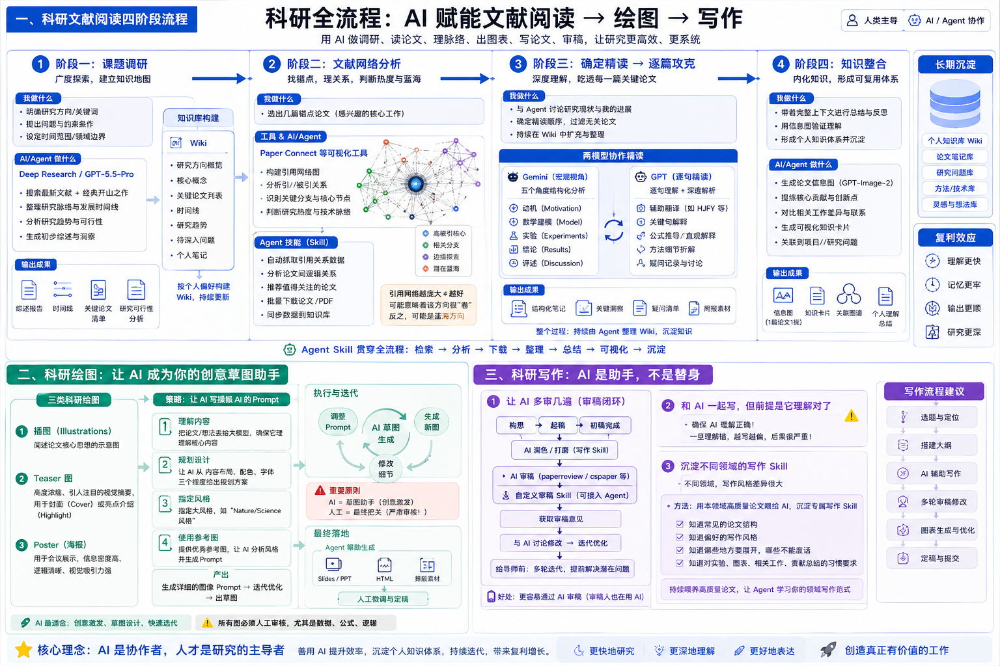

这里给大家安利一下我现在比较稳定的一条科研工作流：**调研 → 筛选 → 精读 → 整合**，不要让 AI 替我们读，我们需要让它帮我们把文献网络、论文细节和个人理解衔接起来。

### 科研文献阅读
我把文献阅读分成四个阶段：**调研→筛选→精读→整合**。

#### 阶段一：课题调研

我主要用 **ChatGPT** 的网页版做课题调研和可行性分析。我会要求 AI 不仅提供最新文献，还必须包含该领域的**开山之作**，之后再让 Agent 按照我的个人偏好去构建文献 `wiki`。

#### 阶段二：文献网络分析（Literature Network Analysis）

找到几篇感兴趣的论文以后（也就是先找到**锚点论文**），借助 **Paper Connect** 等工具，可视化文献间的引用关系，快速判断**研究热度**与**技术脉络**。（这些数据也应该同步导出给 Agent）

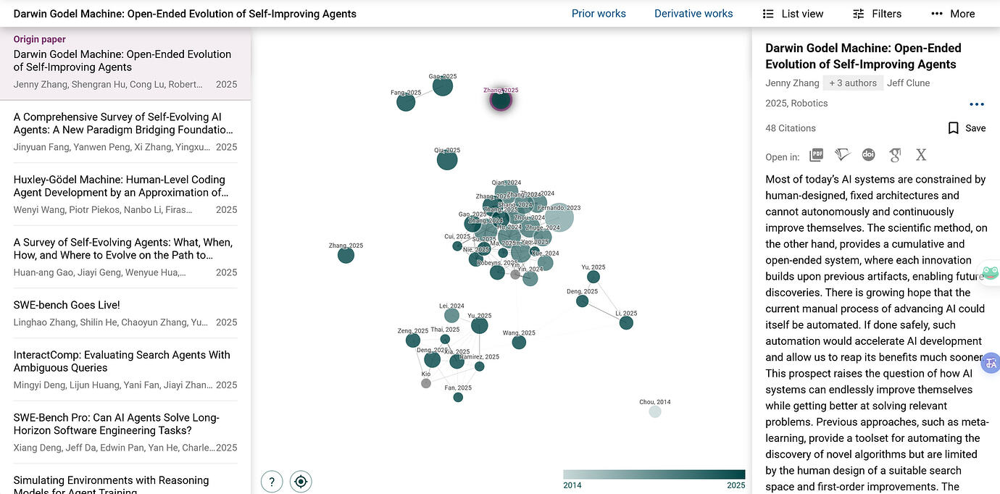

与 Agent 沟通调研结果，搞清楚这些文献之间的逻辑关系，最终下载感兴趣的相关论文以供后续引用或精读。

> 如果某篇论文的引用网络图非常庞大，说明这个方向已经很"卷"了。反之，可能还是蓝海。

#### 阶段三：确定精读 → 逐篇攻克

下载论文到相关文件夹以后，我会先和 Agent 讨论一下当下研究已经推进到了什么地步，粗读alpharxiv的blog模式有个大概了解后再确定阅读顺序，去除无关或暂时不感兴趣的论文。整个过程要逐步扩充整理 `wiki`。

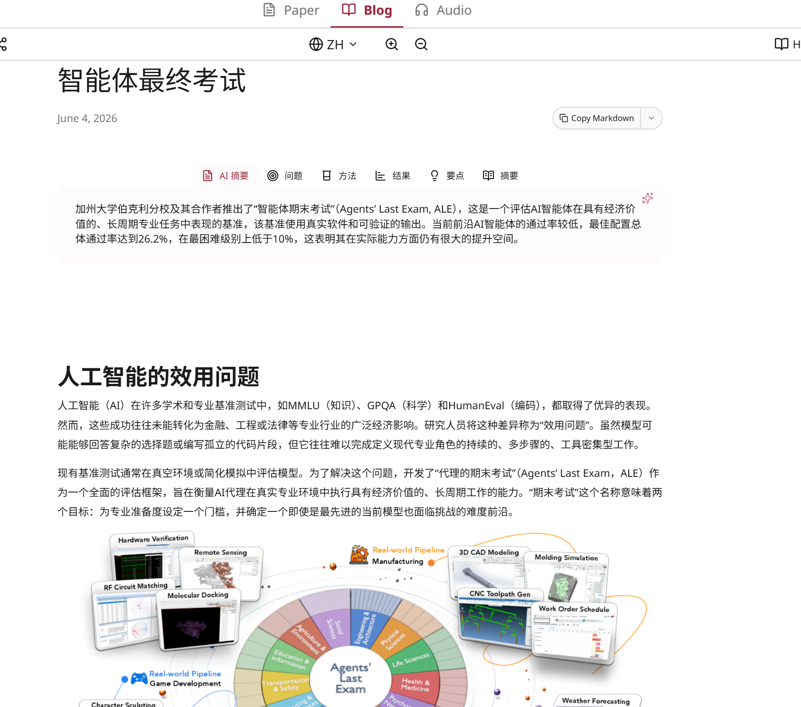

精读环节，我会用**两个模型**配合：

- **Gemini/Claude 负责宏观视角**：从**动机 → 数学建模 → 实验 → 结论 → 评述**五个角度分析一篇论文，生成 HTML 文件，这个格式比较美观，方便截图记录留存。

  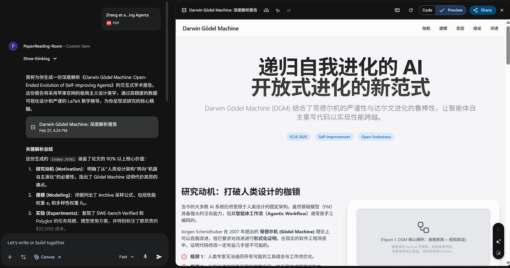

- **GPT 负责更细致的补充**：在 Gemini/Claude 打好的 HTML 基础上继续修改和补充细节，亦或者直接让 GPT 根据模板生成 HTML 文件，同时对照原文分屏快速阅读。具体样子可以参考我的博客：[FormalEvolve Cheat-Sheet](https://cnfjlhj-blog.pages.dev/research/formal-math/autoformalization/formalevolve-cheatsheet/)。

  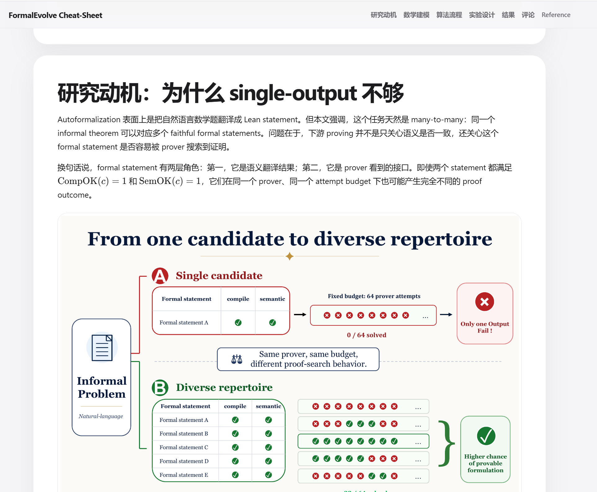

> 这个流程对应的 `paper2html` Skill 我也放进了这个仓库的公开 skill 包里，适合把论文 PDF / arXiv / OpenReview / LaTeX source 转成中文 HTML 精读页。

#### 阶段四：知识整合

精读讨论清楚了以后，带着完整上下文让 Codex 调用 GPT-Image-2 生成信息图（一般一篇论文一张足矣），再带着个人理解与这张图做交叉验证，最终存档。我很喜欢这样像蜘蛛结网一样不断扩展的过程，可以逐渐扩大我的知识可及性。

在执行这些过程时，通过 Agent 的 `Skill` 打通各个环节，提升速度，带来复利。

---

### 关于科研绘图

#### 区分科研绘图的三个类别

科研绘图分为三类。明白这些术语，可以更好地操纵模型绘图：

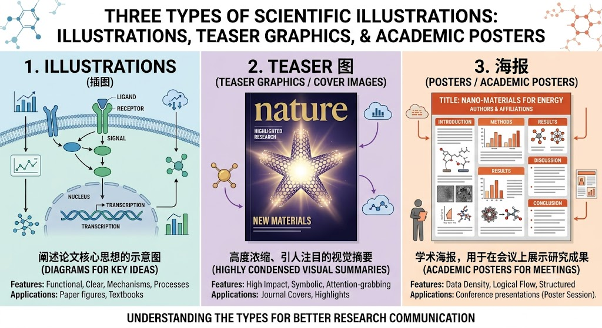

- **插图（Illustrations）**：阐述论文核心思想的示意图

- **Teaser 图**：在学术界，通常指为一篇论文制作的高度浓缩、引人注目的视觉摘要，常见于顶级期刊的封面（Cover）或亮点介绍（Highlight）

- **Poster（海报）**：学术海报，用于在会议上展示研究成果，要求信息密度高、逻辑清晰且视觉吸引力强

#### 策略：让 AI 写操纵 AI 的 Prompt

我发现让模型去生成 Prompt 的水平远超我自己，尤其是科研绘图方面。让我自己描述，我几乎完全描述不清楚。

我会先让大语言模型理解我的论文内容，然后由它来创造和优化用于生成图像的详细 Prompt。具体来说：

1. 把论文/想法丢给 AI，先问它在**内容布局、配色、字体**三个维度上如何规划

2. 可以主动指定大风格，比如 **Nature / Science 风格**

3. 一个很有效的技巧是**使用参考图**：把日常积累的优秀插图丢给 AI，让它分析风格，再基于你的论文内容生成新图像。

目前我还是把 AI 作为**草图助手**。出了草图以后，我会尽可能让 Agent 帮我做成 slides 或 HTML，再由我自己微调。AI 绘图需要大量迭代和多次尝试。目前 AI 最适合的角色，还是**创意激发和草图设计助手**；所有生成结果，尤其是涉及**数据和逻辑**的部分，依然必须经过严格的人工审核与修正。（严肃！）

---

### 关于科研写作

#### 让 AI 多审几遍

现在 AI 审稿越来越严重，尤其是在 AI 领域。论文构思好以后，起稿阶段就可以先用相关的论文润色 Skill 辅助打稿。有了相对完整的草稿以后，建议多用专业的审稿 Agent 来审。我目前主要用 `paperreview` 和 `cspaper` 这两个网站，前者好像可以无限用，后者每个月有免费次数；另外我也做了一个可以给 Code Agent 调用的 `paperreview` Skill，放在 GitHub 仓库里了。拿到审稿意见以后，再和 AI 讨论哪里需要修改。在给导师看论文之前，先多迭代几轮，把一些潜在的小问题尽量提前解决掉。

另外，其实这样写出来的论文也更容易被 AI 认可；如果审稿人本身也在用 AI 审稿，可能会更容易给不错的分数。不过还是要对自己的论文负责。

#### 和 AI 一起写，可以，但前提是它真的理解对了

一定一定一定要确保 **AI 对内容的理解是正确的**。一旦理解错了，后面越写越多，越写越偏，非常危险！

#### 沉淀不同领域的写作 Skill

不同领域的论文，写作风格是不太一样的。

有的领域注重严谨推导；有的领域看重叙事铺垫；有的领域对实验细节特别敏感。

所以与其每次都去重新教 AI “这类论文应该怎么写”，不如先拿通用的科研写作 Skill 作为底子，然后喂本领域你认可的参考论文，慢慢沉淀出一个更适合你自己领域的写作 Skill。

这个 Skill 不需要多复杂，但它最好是：

- 知道你这个领域常见的论文结构

- 知道你偏好的写作风格

- 知道哪些地方要展开，哪些地方不能废话

- 知道你对实验、图表、相关工作、贡献总结的习惯要求

如果看到读起来特别舒服的高质量论文，也记得让 Code Agent 去学习一下。

### 关于知识理解

相信大家在社交媒体（比如B站，小红书）上已经见过了Opus-5.5制作的各种视频。我第一次看到这样的视频其实还挺怀疑的（这真的是这么简单的一句话prompt就能达到的效果吗？）我发现有时候只要给定主题和参考材料，就达到比较惊人的效果。（比如我原先看过有关自指的科普视频，总共大概有两三个小时的时长，让opus-5.5做的视频的效果我觉得也基本覆盖到了，并且就短短做了五分钟也能让我有新的启发）它在组织内容、选择视觉表达方式以及解释某些概念时，体现出了一种让我惊讶的理解能力。以前我总觉得，AI 可以帮助执行创意，但真正决定什么是好的、什么能够打动人的 Taste，应该还是人类更擅长的事情。但这个模型让我第一次很直观地觉得，也许我们所谓的 Taste，同样在 AI 的射程之内。

回到实际应用，如果你有比较充足的 token 预算，我觉得 Opus-5.5 非常适合用来制作知识讲解材料，尤其是把比较抽象的概念转化成直观的视频或动画。没有条件使用的话，也可以尝试 NotebookLM 、GPT 的图像生成功能，或者直接使用 ChatGPT 网页端进行讲解。

（PS：最近我觉得 GPT 的网页端非常好用，讲解部分知识跟 Opus-5.5 有得一拼，可能是又路由新模型了。）

## 三、Code Agent 使用指南

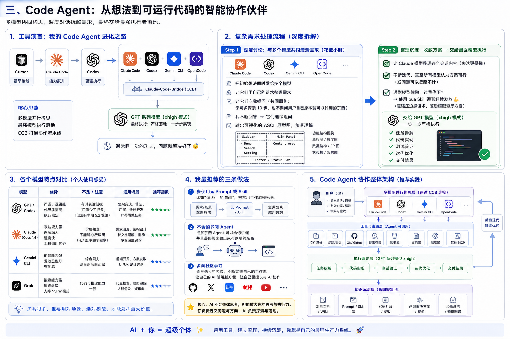

### 工具演变

我最先接触 Code Agent 的是 **Cursor**，后面逐步进化到 **Claude Code** 与 **Codex** 这些。我现在基本只使用 Pi，通过 HAPI 调用。

#### Pi-Agent

我觉得如果是Code Agent的重度使用者，并且乐于折腾的话，都可以尝试一下折腾Pi。在使用Pi的过程明白Agent的原理以及组织方式，从最简化的Agent出发，逐渐构建开发自己需要的并且有用的工具/插件。

但是因为一开始Pi就是一个毛坯房，什么都没有，所以可以把自己平时使用的Agent和pi同步使用，发现有任何不舒服的地方就和Agent一起研究如何解决。这样来回迭代一段时间会有质的飞跃。

这里同时也推荐一下magic-context这个工具，个人也比较认可这种管理上下文的方式。本质就是在每轮模型调用前，对上下文先进行一些操作。

### 心流状态：人和 Agent 都要减少摩擦

频繁使用 Coding Agent 以后，我反而发现自己有时候更难进入所谓的“心流状态”。原因不是 Agent 不够强，而是 Agent 介入以后，人的工作方式会被改变。GUI 来回点、鼠标切窗口、到处 `cd`、临时查命令、等 ChatGPT 解释一大段过程，这些动作单独看都不大，但叠在一起就会不断打断注意力。最后表面上是在高效使用 AI，实际上人一直在被迫切换上下文，给人带来一层**“上下文税”**。

人和 Agent 最好是能待在一个**连续的操作回路**里：**搜索、打开、查看、处理、验证**，尽量不要中途跳出当前现场。对人来说，CLI、快捷键和模糊搜索很重要。比如用 `fzf` 快速找历史命令或文件，用 `yazi` 在终端里浏览目录，在 macOS 上用 `open -a Preview` 直接打开 PDF 或图片。它们不是“炫技”，而是减少从思考到操作之间的阻力。少一次鼠标切换，少一次窗口跳转，人会更容易保持连续性。

对 Agent 也是一样。Agent 的能力不只取决于模型本身，也取决于它会不会**选对工具**。搜索代码时应该优先用 `rg` 或 `rg --files`，处理结构化数据时应该用 `jq`，临时 Python 依赖可以用 `uv run --with`，音视频处理应该想到 `ffmpeg`，图片处理应该想到 `magick`，PDF/LaTeX 相关任务应该知道 `poppler`、`xelatex` 这些工具。**工具选错了，模型再聪明也会慢、会错、会做出很蠢的行为。**

所以我现在会特别注意 review Agent 的过程。重点看它用了什么工具，有没有过早退而求其次，有没有忽略 GPU、远程机器或专用工具，有没有明明存在更快路径却用慢方案硬跑。比如做 Whisper 转录时，如果本来可以走 Apple Silicon / Metal / MLX 加速，却退回 CPU 跑半小时，这就不是“慢一点而已”，而是**工作流规则没有写清楚**，模型也没有 get 到。我们遇到这种情况，比如一次发现 `rg` 比普通搜索更适合项目级代码检索，就不只是自己记住，而是写进 `AGENTS.md` 或 Skill。一次发现 `uv run --with` 很适合临时 Python 依赖，也写进规则。这样下次 Agent 不需要重新“猜”，而是默认走更合理的路径。

我觉得有两件事特别重要：
1. **先走最佳实践，不要一开始就退而求其次。** 如果正确路径连续尝试几次仍然不可行，再有意识地 fallback，并说明为什么 fallback。
2. **人必须理解基本概念和原理，才有能力 review Agent 的自动过程。** 不懂工具链、不懂任务本身的约束，就很难看出来 Agent 是真的做对了，还是只是把话说圆了。

所以 Code Agent 的“心流状态”，不是完全放手让它自己跑。更准确地说，是人把**任务意图、工具选择和验收标准**都约束清楚，人减少无意义操作，Agent 减少无效试错。让 Agent 在正确的轨道里高速推进。

### 复杂需求的处理流程

简单需求就不展开了。说说复杂需求怎么做（参考刘小排的经验）：

**把模糊的想法逐渐写清楚**

事实上我的很多个想法都是极其模糊的，可能我想的一两句话背后有十几个决策点需要关注。具体做法是：我会先开启头脑风暴模式，相当于用 subagent 的方式：一个模型当裁判，把同一个问题发给不同模型（GPT-6.1 Sol、Opus-5.5、GLM-5.2、DeepSeek-V4-Flash）。让它们用自己的话术整理需求，然后逐个向我提问；这里推荐一个不错的 skill，叫做 **`grill-me`**。接着我不断回答各个 AI 提出的问题，AI 继续追问。这个过程要让 AI 多输出可视化的 **ASCII 原型图**，加深自己的理解。不断让 Claude 模型去整理各个会话的内容（Claude 的模型说得容易懂），迭代直到所有 AI 都认为当前的方案已经没有问题，或者问题可以忽略不计，最终交给 GPT 模型通过类似`/goal` 的模式完成即可。（其实我已经很久没有开过 goal 模式了，用 GPT 模型的话通过 Magic Context 一般都能达到像 goal 一样的效果）

### 各个模型特点

- **GPT / Codex**：比较严谨。GPT-6.1 sol貌似和GPT-6-Astra在质量上差不多，但是速度上Astra快得多。比较擅长数学推理这样的问题（毕竟严谨性拉满）

- **Claude（Opus-5.5）**：表达能力强，速度快，真正的六边形战士，审美和哲思能力NO.1，但Anthropic封号政策太严格了。

- **Gemini**：前端能力很不错，很适合用来发散思维，有很丰富的世界知识，有时候聊方案的时候会有意想不到的效果。听说Gemini的新模型挺厉害，还没有实际体验过。

- **Grok**：搜索能力很优秀，在审查上应该也是最松的，还有 NSFW 模式。推荐 `grok-search` 这个 MCP 搭配其他 Code Agent 使用。

### 推荐的使用方法论

1. **多使用元 Prompt 或 Skill**——比如造 Skill 的 Skill，把常用的工作流模板化。

2. **不会的多问 Agent**——很多东西 Agent 可以给你讲懂，并且最终落实做出来可以用。就不断迭代积累经验。

3. **多向社区学习**——参考他人的经验，不断完善自己的工作流，让自己的 AI 越用越方便，让自己更擅长与 AI 协作。

---

## 四、对抗虚假生产力
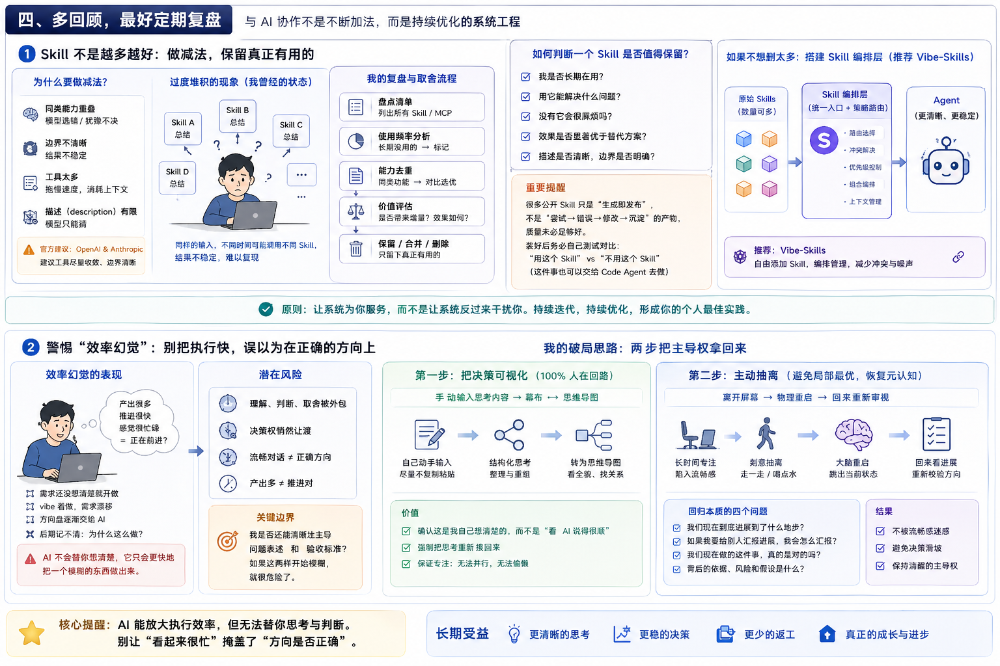

### Skill 不是越多越好

**Skill / MCP 不是见一个就安一个。** 我原先就是这样，遇到一个看起来不错的 Skill，就想让我的 Code Agent 给装上。最近回头复盘才发现，自己这里已经堆了很多做同一件事的 Skill。给同样的输入，有时候模型选 A，有时候选 B，有时候选 C，结果并不稳定。毕竟模型在选 Skill 的时候，设计上只能先看 `description`。

OpenAI 和 Anthropic 都在官方文档里提到过，相关工具最好尽量收敛一些。当**工具数量太多、同类能力重叠、边界又写得不清楚**时，模型更容易选错、犹豫、变慢，甚至被长输出拖垮上下文。

所以我现在会定期回头复盘自己的 Skill 和 MCP，看它们到底有没有真正给我带来增量，我到底有没有长期用到它们。如果一个 Skill 只是“当时看起来很厉害”，但后来几乎不用，或者和别的 Skill 做的是同一件事，那我就倾向于把它关掉，甚至直接删掉。相反，如果我发现一个东西自己反复在用，而且确实好用，我就会继续往里看，搞清楚它到底为什么好用，再决定要不要把它沉淀成自己更稳定的一套东西。

另外，其实现在很多网上公开的 Skill，都是遇到需求以后直接让模型写出来的，而不是“尝试 → 错误 → 修改 → 沉淀”的产物，质量未必足够好。装好以后最好自己测一下，看看“用这个 Skill”和“不用这个 Skill”之间到底有没有差别；这件事也可以交给 Code Agent 自己做。

这只是其中一个例子。和 AI 协作不是不断往系统里加东西，有时候**做减法更有用**：留下有用的，去掉噪声。

### 警惕“效率幻觉”

不知道大家有没有这种感觉：每天用 AI 写代码的时候，产出看起来很多，推进也很快，但等真正沉下心回顾时，却很难说清楚自己到底做了什么，甚至有时候连当时为什么要那样做都不一定想得起来。

某种程度上，AI 把“做”的门槛压得很低，于是人很容易在需求还没想清楚的时候就先开做。想着“这个功能先 vibe 一下再说”，结果写着写着，**需求开始漂，方向盘也交了出去**。你没有想清楚，它也不会替你想清楚，它只会更快地把一个模糊的东西做出来。

如果只是一味把 AI 当替身，让它一路写、一路改、一路带着你走，那本来应该由自己完成的**理解、判断和取舍**，也会一起被外包出去。最后得到的，可能不是更强的能力，而是一种**“虚假生产力”**。

对我来说，一个很重要的边界就是：我是否还能清晰地主导**“问题表述”**和**“验收标准”**。如果这两样开始模糊，那就很危险了。如果你自己都还不知道想要什么，就先别急着干。否则可能后面看起来还在推进，但推进的东西到底对不对，自己其实已经没那么确定了。

我对抗“效率幻觉”大概有两步。

**第一步，是把决策可视化。**

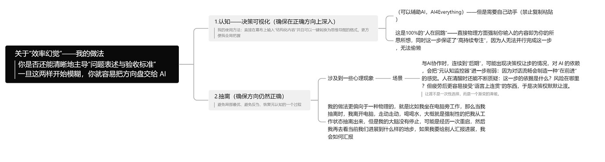

我会尽量把自己思考的东西打出来，输入到幕布里，再转成思维导图去看。这里最关键的不是工具，而是**要自己动手，尽量不要复制粘贴**。AI 可以辅助，但这一步我更希望是我自己在输入、在整理、在重新组织。因为只有这样，我才能确认这些内容真的是我自己想清楚的，而不是只是看 AI 说得很顺，就默认它是对的。

某种意义上，这一步对我来说是 100% 的**“人在回路”**。它会在物理层面强制我把思考重新接回来，同时也能保证持续专注，因为这件事没法并行，也没法偷懒。

**第二步，是主动抽离。**

抽离对我来说，不只是休息一下，而是一个避免局部最优、避免反刍、恢复元认知的过程。

因为和 AI 协作久了以后，很容易出现一种情况：对话越来越顺，内容越来越连贯，于是人会慢慢产生一种“我们正在前进”的感觉。问题在于，这种**流畅感本身就会削弱人的警惕性**。清醒的时候，你还会不断追问：这一步的依据是什么？风险在哪里？但到了后期，尤其是累的时候，人更容易接受那些“语言上讲得通”的东西，于是决策权就会默默让渡出去。

而且这种让渡通常不是一下子发生的，它更像是一个渐变的滑坡。

所以我的做法会更偏物理一些。比如我坐在电脑前工作一段时间以后，会刻意离开电脑，站起来走一走，喝点水，强制把自己从当前状态里抽出来。我的大脑并没有停止，只是像经历了一次重启。然后我再回来重新看：**我们现在到底进展到了什么地步？如果我要给别人汇报进展，我会怎么汇报？我们现在做的这件事，真的是对的吗？**

对我来说，这一步很重要。因为很多时候，所谓“效率幻觉”不是你做得不够多，而是你已经做了很多，但你开始说不清自己到底为什么这么做了。

### 解放双手，学习“闲下来”
说一个听起来有点反直觉的事：我反而希望自己的工作时间尽可能少。

人一天真正有效的专注产出，大概也就七八个小时，这是有上限的。与其拉长工作时间，不如想办法压缩总时长、提高有效专注的密度。我最近用番茄钟记录自己的专注时长，目的不是"卷更多"，而是反过来——清晰地看到自己今天真正专注了多少，然后心安理得地停下来。

更重要的是，很多时候创新恰恰不是在专注时发生的，而是在闲下来、没想任何事情的时候，突然灵光一闪出来的。专注负责执行，闲下来负责连接。如果你把所有时间都填满"在做事"，反而把灵感出现的缝隙堵死了。我认为“闲下来”在这个时代与“专注做事”是同样重要的。

---

## 五、AI时代生存（学习）指南
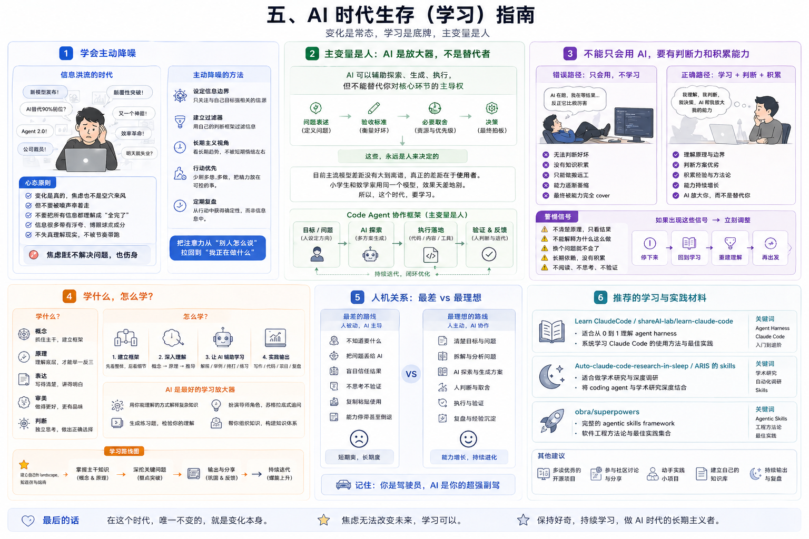

### 学会主动降噪

这是一个什么时代呢？因为我有每天听播客、看最新动态的习惯，很容易会有一些错觉：好像每天都有新模型、新工具、新 Agent 发布，感觉世界每天都在被重写。

变化当然是真的，焦虑也不是空穴来风，很多岗位裁员是真的，岗位收缩是真的，很多公司也确实把 AI、效率、组织重构这些话术和 headcount 变化绑在一起。但越是在这个时候，越不能**被噪声牵着走**，把所有信息都理解成“全完了，过一阵子就全部都失业了”。

同时，要明白很多信息本身也带着浮夸、博眼球的成分。不要失真地理解现实，不要被节奏带跑，焦虑地过日子，焦虑既不解决问题，也伤身。

### 主变量是人

目前，AI 可以辅助**探索、生成、执行**。但是不能替代你对**问题表述、验收标准、必要取舍和决策**的主导权。这应该要成为共识。

变化是真的，所以不能躺平；起码在现在这个阶段，大家能用到的 AI，无论是 GPT、Claude、Gemini，还是国内的 GLM、DeepSeek、Kimi、MiniMax 等等，差距没有大到离谱的程度。（当然，能用最好的还是用最好的）

更大的区别还是在于**用 AI 的人**。同样的一个模型，不同的人用出来的效果是不一样的。小学生和数学家用同一个 AI 去做数学，最后发挥出来的力量肯定是不一样的。所以说，这个时代，要学习。

如果你完全不懂你现在让 AI 做的事情，那你几乎是无法判断和分辨好坏的，也是无法做到经验累积的，你只能做一个搬运工。而这样长期下去，**过度依赖 AI 而不学习会导致能力萎缩**，最终个人能力可能逐渐倒退至完全被 AI 的能力所 cover，这是很可怕的一件事情。

如果你发现 AI 在跑，你只是盯着控制台发呆，刷手机，最后再把结果原样拿来用，或许该警惕了。

如果把“人是主变量”这件事再画得更直接一点，大概就是下面这个样子。

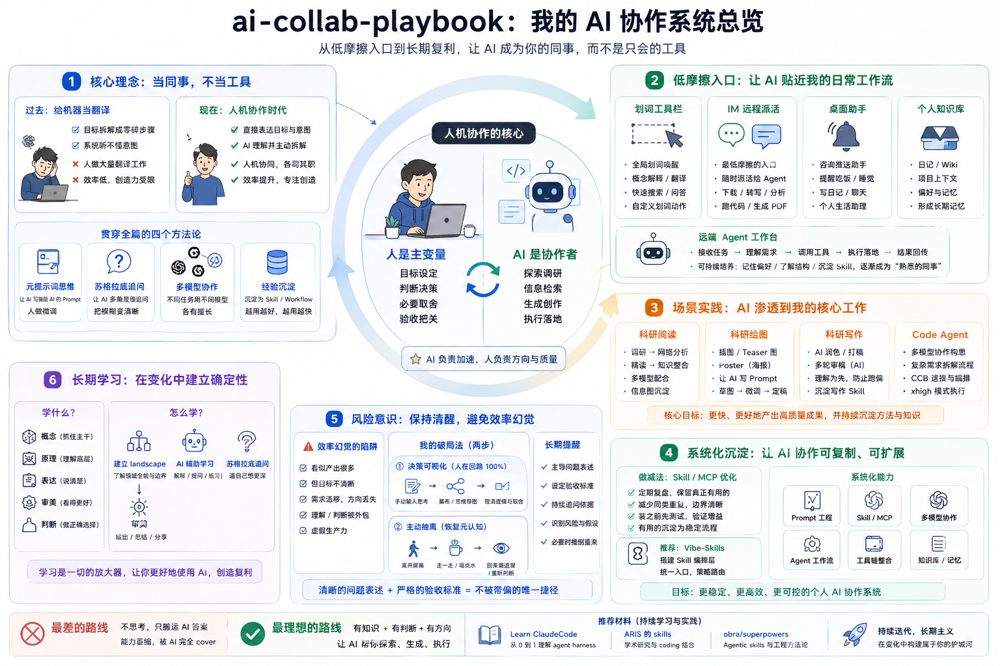

### 学什么，怎么学

学什么呢？去学**概念、原理、表达、审美、判断**。

决定能不能进入一个领域的概念与原理的知识是不会太多的。抓住这些**主干**，你就能够更快进入这个领域的 space，知道它的大致边界、结构和内在关系。

所以不要碎片化地去追热点，什么火去学什么，可能这样学到的只是表象。应该要去学概念，学原理。**建立起自己的地图**，知道自己在哪，知道哪些概念是主干，哪些是枝叶。然后让 AI 帮你逐步展开、解释、练习。

这是一个非常适合学习的时代。我个人深切感受到了，很多过去晦涩难懂的知识，现在都可以让 AI 用你能理解的话解释；也可以扮演导师的角色拷打你，可以用苏格拉底式的问答逼你去把问题想得更深一点。

### 人机关系

有关人机关系，我想到的最差的关系是：**自己不思考，只会搬运 AI 的答案**。

最理想的路线是：**自己有知识基础，有判断力，知道什么是好的，知道自己想要什么**，然后让 AI 去帮你探索、生成、执行。但这里的关键不是“AI 帮我生成了多少东西”，而是我是否还有能力判断这些东西到底对不对、好不好、值不值得继续。

我以数学研究为例。数学研究里有两个核心环节：生成证明和评价证明。在 AI 之前，这两件事基本是平衡的：生成证明很慢，评价证明也很慢。但 AI 到来以后，生成证明正在变得非常廉价。随着模型能力继续增强，未来它生成出来的东西大概率会越来越接近正确，真正稀缺的反而会变成评价能力：你能不能看出一个证明哪里不严谨，哪里跳步了，哪里只是语言上很顺，但本质上没有解决问题。

这件事放到科研和开发里也是一样的。AI 让“生成”变得越来越容易：生成代码、生成论文段落、生成方案、生成图表、生成想法。但越是这样，人越不能只做一个接收输出的人。人的价值会越来越集中在问题表述、判断标准、验证能力、审美和取舍上。

这也是我为什么越来越觉得，工业革命以来那套教育体系里很大一部分是在培养“工具人”：每个人的价值被定义为能否成为社会机器上的一个有效零件。但如果 AI 在越来越多赛道上都能超过人的工具属性，那么人继续和 AI 比“谁更能干活”，大概率是会输的。我们需要重新定义人的价值，而不是继续把自己训练成更高效的工具。

所以我现在对“人机关系”的理解并不是“把事情交给 AI，我就轻松了”。恰恰相反，在很多严肃任务里，AI 越聪明，人反而越累。

因为我不能简单接受它的答案。我需要仔细验证它的过程，因为它确实会骗我、瞒我，也被我抓住过很多次；我需要在科研、开发和创意写作里反复甄别哪些地方没有达标；我还需要像带学生、带孩子一样带它，教它做事，检查它的输出，把它拉回正确轨道。

这个过程非常累。但如果你想驾驭它，就必须这样。否则就不是在使用 AI，而是在向 AI 投降。

我现在甚至有一点庆幸：我还能经常发现它做得不好的地方。真正让我担心的不是 AI 会不会犯错，而是如果有一天它犯错、偷懒、绕开问题的时候，我已经看不出来了，那它可能才是真的在某种意义上超过我了。

### 推荐的一些材料

如果你暂时找不到意义，不知道这样飞速发展的时代应该做什么，感到焦虑和迷茫，那么去学习吧。如果暂时不知道学什么，或者想从 coding agent 这条线入门，我推荐几个对我来说帮助比较大的材料：

- **Learn ClaudeCode / `shareAI-lab/learn-claude-code`**

  适合从 0 到 1 理解 agent harness。学了以后也要多实践。

- **Auto-claude-code-research-in-sleep / ARIS 的 skills**

  适合做学术研究，尤其是如果将 coding agent 与学术研究结合。

- **`obra/superpowers`**

  适合看一套完整的 agentic skills framework 和软件工程方法论。

- **Crash Course**

  我很喜欢的科普类课程

---

## 六、对于我来说，不得不思考的一些问题

### 当未来 AI 产品与我们生活方方面面紧密结合时，会发生什么？

我现在也会警惕另一件事：人和 AI 协作久了以后，不一定只是效率更高了，也可能是在慢慢学会用 **AI 听得懂的方式**去表达自己。目标可能会变得更结构化，更 AI friendly，原本那些模糊、犹豫的东西是不是会慢慢变少？短期看，是沟通成本变低，执行变快，效率变高了；但反过来看，是不是也意味着我们也正在一点点变成一个**更容易被系统理解、也更容易被系统预测的人**呢？

另外，这种变化不是单向的，AI 会通过我的历史行为学习我，而我也会通过和 AI 协作的反馈学会怎么更快地得到结果。久而久之，就可能形成一种闭环：我越来越习惯某种提问方式、某种表达风格，而 AI 也会越来越顺着我。可这就是问题，它这样做太容易让人觉得“这就是我的想法”了，实际上可能是一种坍缩。看似是 AI 和人共同进化，实际上有可能只是**你变简单了**。

所以，我们需要 AI 提供新的视角，也需要保留质疑它的能力；可以接受它的建议，也应当有机会重新审视自己的选择。比如，每天给自己留出一段“去 AI 化”的时间，独立思考、独立阅读、独立写作。我们需要为自己的认知系统保留不同的信息来源、不同的反馈，以及独立思考的空间。

(对于这一块我觉得Human Finds a Way的那篇说的更详细，感兴趣的友友们可以看那篇的“四、与另一种智能共同演化”部分)
